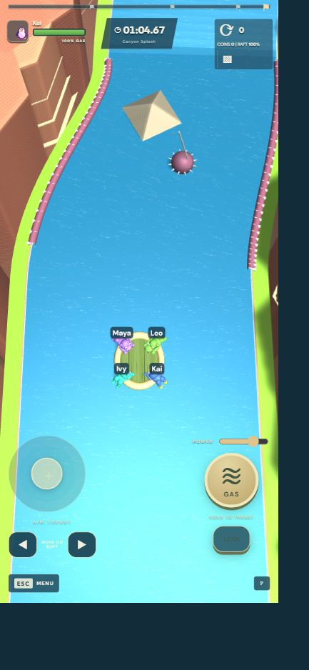

# FART CREW — cooperative raft game

One crew steers one raft with manually triggered fart thrust. Four players are standard; an optional larger raft supports eight. Players grip the rim, shuffle sideways, coordinate thrust and balance, and avoid spikes. One spike contact pops the raft and fails the whole crew.

**The Android app requires a running game server, including solo practice and local shared-screen play.** The APK contains graphics and controls; the Node.js server owns the physics and game state. Hosting on your PC is sufficient for same-Wi-Fi testing. Internet play needs a publicly reachable server. GitHub stores the code and builds; it does not run this multiplayer backend.

## Start here

- **[Deploy on Render with internet crew voice](docs/RENDER.md)** — free server Blueprint, CI/CD, TURN relay setup and phone verification.
- **[Complete step-by-step setup and hosting guide](docs/SETUP.md)** — server setup, Android installation, Wi-Fi troubleshooting, cloud deployment, APK builds and maintenance.
- **[Download the signed test APK](artifacts/Fart-Crew-v1.9-debug.apk)** — Android API 23+, online server selected automatically. [Checksum](artifacts/Fart-Crew-v1.9-debug.apk.sha256).
- **[APK installation notes](artifacts/INSTALL-v1.9.md)** — automatic online connection, sound selection, boat colours and wider mobile camera.
- **[Track generator design](docs/track-design.md)** and [sample map](levels/canyon-coop.json).

## Quick local run

Install Node.js 22 LTS and Git. In PowerShell:

```powershell
git clone https://github.com/jithinjose0/FT-Game.git
cd FT-Game
npm ci
npm run build
npm start
```

Open `http://localhost:2567/health`; expect `{"ok":true,...}`. The browser game is at `http://localhost:2567/`. Keep the terminal and PC running. To edit code with hot reload instead, use `npm run dev` and open `http://localhost:5173/`.

On a phone connected to the same Wi-Fi, open `http://YOUR-PC-IP:2567/health` in Chrome **before** testing the APK. Then install the APK and use **Settings → Multiplayer server → `ws://YOUR-PC-IP:2567` → TEST CONNECTION → SAVE SERVER**. Every phone in one crew must use the same backend. Do not enter `localhost` on the phone.

The PC Wi-Fi address checked on 20 October 2026 was `192.168.1.6`. The server responded on port 2567 and the running Node executable had inbound firewall allow rules. Phone Chrome still reported unreachable; confirm the Wi-Fi path or test through the PC hotspot before changing firewall rules.

## Controls

| Action | Desktop | Touch |
| --- | --- | --- |
| Steering | Coordinate gas from different seats | Coordinate gas from different seats |
| Thrust | Hold Space | Hold GAS |
| Shuffle sideways | Q / E | MOVE ON RAFT arrows |
| Balance | Shift + direction | LEAN forward |
| Thrust strength | Power slider | Power slider |
| Session menu | Escape | Menu |

Release GAS to refill fuel. There is no automatic river thrust or boost-pad impulse. Retained momentum, collisions and downhill gravity still apply. Reset voting needs half the crew and adds five seconds; spike failures instead require the host to choose TRY AGAIN. Gamepad and additional local keyboard layouts are covered in the setup guide.

## Project layout

| Directory | Purpose |
| --- | --- |
| `packages/client/src` | Babylon.js renderer, controls, UI and networking |
| `packages/client/android` | Versioned Capacitor Android project and debug LAN configuration |
| `packages/server/src` | Colyseus rooms, authoritative Havok physics and score storage |
| `packages/shared/src` | Network types, course geometry and standalone spline generator |
| `levels` | Generated sample track data |
| `tests` | Physics, multiplayer, lifecycle and generator checks |
| `supabase/migrations` | Optional database schema |
| `artifacts` | Installable test APK, checksum and installation notes |
| `tools` | Generator, Windows build helper and opt-in firewall tools |

The standalone spline graph generator is **not yet integrated** into the playable course system. Current game courses use the shared winding/elevated Z-based path implementation. Havok handles horizontal collision/rotation; authoritative vertical logic handles ramps, jumps and falls. It is a 2.5D simulation rather than full fluid buoyancy.

## Validation

```powershell
npm run typecheck
npm test
npm run build
npm run generate:track
```

The version 1.1 gameplay checks passed all **23 tests**, TypeScript checks and the production build. Four connected players were checked in portrait browser views, including independent inputs, visible names and banks, shared spike failure and host restart. The Android debug APK compiled and its v1/v2 signatures verified. Physical Android gameplay has not been verified; phone-to-PC connectivity was reported blocked. iOS has not been compiled on this Windows host.



The client UI currently includes a recovered compiled module under `src/recovered/`; it remains an active build input. Do not delete it as a generated asset. Downloaded SDKs, credentials, caches, dependencies, copied web assets and local game records are excluded from Git. No release-signing private key is included.

This is an original implementation inspired by the supplied gameplay reference, with procedural animal models and scenery. The original game's proprietary assets are not included. Reference: [gameplay clip](https://www.youtube.com/watch?v=H5TfOZ7bqWA).


## Version 1.1 mobile update

Sharper device-resolution rendering (up to 2.5x), a 15% larger hull, larger animals, longer gas duration and trails, crew-timed forward thrust without a direction joystick or aim ring, and hull-aware spike contact before and after physics resolution. Crew voice is opt-in; see [voice and internet setup](docs/VOICE.md) for TURN relay configuration and device-testing limits. Friends outside Wi-Fi need the same publicly hosted WSS backend and a room code.

Version 1.2 aligns gas trails to each animal's rear and authoritative force to its facing. Opposing seats cancel; coordinate the rear pair to move forward. Exhaust follows the rendered character transform as the boat rotates or players shuffle.

Version 1.3 removes circular wake effects. Gas originates at the rendered rear of each animal, follows its full current transform, and inherits raft velocity so sideways boat movement does not bend the exhaust away from the character.

Version 1.4 adds synthesized sputtering fart audio for every firing crew member, scaled by thrust strength. Sound effects can be disabled in Settings and stop when thrust ends, menus open, the round ends, or the app is hidden.

Version 1.6 enables full-sensor Android rotation and responsive portrait/landscape controls without recreating the room. The river has turquoise shallows, animated ripple normals, textured natural banks, grass-covered cliffs, rounded boulders, reeds, shrubs and flowers. Browser rotation is verified; physical-device rotation still needs a phone check.

Version 1.7 adds a manual PORTRAIT / LANDSCAPE button in the Android app and remembers the chosen orientation. Mobile gameplay uses a closer camera; the wide bird view remains available. Emerald water has moving downstream highlights, banks use richer greens, and the raft has warm timber, rope trim and a forest-green hull. The manual native button still needs a physical-phone check.
