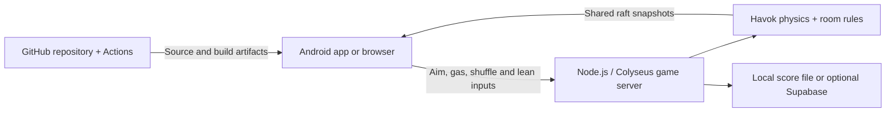

# Server, Android and online hosting — step by step

## 1. Understand what runs where



The app bundles the 3D renderer, animal models, UI, effects and controls. It sends inputs about 20 times per second. The backend owns the raft and collisions, simulates at 60 Hz, and broadcasts snapshots at 30 Hz. Clients interpolate those snapshots. A room code identifies one shared game; all phones must connect to the same server before that code can work.

**A server is required for all current modes**, even one player or several players on one screen. There is no on-phone offline physics server. The app cannot continue a game if the server stops. Active rooms are in memory and disappear on a server restart/deploy. Supabase, when enabled, stores records; it does not run the game simulation.

| Your situation | Server needed | Public/cloud hosting needed |
| --- | --- | --- |
| Browser on your own PC | Yes, on that PC | No |
| APK and PC on same Wi-Fi | Yes, on the PC | No |
| Friends on different Wi-Fi/mobile networks | Yes, reachable by everyone | Use a hosted server with HTTPS/WSS |
| APK with PC off and no cloud server | Not available | A server must be started somewhere |

GitHub hosts source, APK files and CI jobs. GitHub Pages is static hosting and cannot run this Node/Havok backend. Pushing this repository does not automatically deploy a game server.

## 2. Get the project

Install Git and **Node.js 22 LTS**, which includes npm. Then open PowerShell:

```powershell
git clone https://github.com/jithinjose0/FT-Game.git
cd FT-Game
node --version
npm --version
npm ci
```

Java and Android Studio are not required to run the server or browser game. They are needed only to rebuild the Android app.

## 3. Start the server on your PC

For a normal local run:

```powershell
npm run build
npm start
```

Keep this terminal open. Open these addresses on the PC:

- `http://localhost:2567/health` — must return JSON containing `"ok":true`.
- `http://localhost:2567/` — browser version of the game.

Port **2567** serves both HTTP and WebSocket traffic. The server listens on `0.0.0.0` so local network devices can reach it when the firewall permits. Do not start a second copy on the same port. Stop a foreground server with Ctrl+C.

For development instead:

```powershell
npm run dev
```

This runs the backend on **2567** and Vite on **5173**. Open `http://localhost:5173/`. The APK always talks to the backend on 2567, not Vite on 5173. You do not run npm commands on the phone.

No `.env` file is required for the basic setup. Optional root `.env` values are shown in `.env.example`. `PORT` changes the backend port; `DATA_DIR` changes score storage. A relative `DATA_DIR` is resolved from the server process working directory. Restart the server after editing these variables.

## 4. Prove the phone can reach the PC

1. Connect the phone and PC to the same normal Wi-Fi network. Avoid guest Wi-Fi/client isolation. A private IP such as `192.168.1.5` is not reachable through mobile data or another house's Wi-Fi.
2. On the PC, run `ipconfig` and read **IPv4 Address** under the active Wi-Fi adapter. Ignore WSL, VPN and virtual adapter addresses. The address at the last check was `192.168.1.5`; it can change.
3. On the phone, open Chrome and visit `http://YOUR-PC-IP:2567/health`. For the last checked PC, that is `http://192.168.1.5:2567/health`.
4. Continue only when Chrome displays `"ok":true`. If Chrome cannot reach it, fix the network/firewall first; an APK reinstall will not fix that block.

### The currently diagnosed Windows firewall issue

Historical diagnosis: this PC previously had Public-profile Node.js block rules. On 20 October 2026 the running Node executable instead had inbound allow rules and no matching active block. The server responded at 192.168.1.6:2567 on the PC. Phone connectivity remained unresolved. The scripts below target the old installation and must not be used unless their preconditions match.

If you own/manage the PC and authorize the exception, open PowerShell **as Administrator**, change into this repository, and run:

```powershell
powershell -NoProfile -File tools/enable-phone-lan.ps1
```

Read the script first. It expects exactly the diagnosed Node installation and one Public-profile TCP block. It backs up that rule's port setting, excludes only TCP 2567 from the block, and allows TCP 2567 only for Node from `LocalSubnet` on Wireless interfaces. Other Node TCP ports and the UDP block stay blocked. An explicit block would override a simple allow rule, which is why both changes are necessary. The script stops if the rules differ from the diagnosed case. Administrator credentials may be needed; on a managed work PC, ask IT rather than disabling security controls.

To undo that authorized exception later, from an Administrator terminal:

```powershell
powershell -NoProfile -File tools/undo-phone-lan.ps1
```

The undo script needs the local backup in `artifacts/firewall-lan-backup.json`, which is deliberately not committed. Neither script is run automatically. Do not disable Windows Firewall entirely. On a different PC, use that machine's approved firewall configuration instead of assuming these exact block rules exist.

After an authorized fix, repeat the phone Chrome health check. If it still fails, confirm both devices' Wi-Fi connection, the current PC IPv4 address, VPN policies and router client isolation.

## 5. Install and configure the Android APK

1. Download `artifacts/Fart-Crew-debug.apk` from this repository. GitHub may show a download button rather than previewing the binary. Transfer it to the phone or download the raw file using the phone browser.
2. Open the APK. If Android asks, allow your browser/file manager to install this test app. Use a current Android System WebView with WebGL support; the APK declares minimum Android API 23.
3. Open **FART CREW → Settings (gear) → Multiplayer server**.
4. Enter `ws://YOUR-PC-IP:2567`. For the checked PC: `ws://192.168.1.6:2567`.
5. Tap **TEST CONNECTION**. It should say the server is reachable.
6. Tap **SAVE SERVER**, close Settings, choose your character and choose **ASSEMBLE CREW**.
7. The host shares the six-character room code. On each other phone, save the same server address, choose **JOIN A BOAT**, and enter that code.
8. The host taps **START JOURNEY**. All players now control the same raft.

Do not use `localhost` in the APK: it means the phone itself. Do not include `/health` in the saved server address. `http://` is for browser diagnostics; use `ws://` for this LAN test app, or `wss://` for an internet server.

The current debug APK permits LAN cleartext/mixed-content traffic. Release builds retain secure defaults and should use WSS. The APK has been compiled and its v1/v2 signatures verified, but physical-phone gameplay has not been verified. Its SHA-256 checksum is in the adjacent `.sha256` file.

## 6. Play with four local players on one screen

Choose **Local / shared screen**, set the number of local players, choose names/animals, and assign unique controls. This still uses the backend; no cloud account is needed. Touch controls operate the first local player assigned Keyboard 1. Multiple phones with touch controls should normally use Online/LAN mode, one player per phone.

| Player binding | Aim | Gas | Shuffle |
| --- | --- | --- | --- |
| Keyboard 1 | WASD | Space | Q / E |
| Keyboard 2 | Arrows | Enter | [ / ] |
| Keyboard 3 | IJKL | U | O / P |
| Keyboard 4 | TFGH | R | Y / N |
| Gamepad | Left stick | RT / A | Right stick horizontally |

Shift plus direction (or LB on a gamepad) provides balance input; mobile uses LEAN plus aim. Eight players need the large boat and enough distinct keyboard/gamepad bindings. Browser/OS controller limits and keyboard ghosting need device testing.

## 7. Host the server online for friends outside your Wi-Fi

The repo includes `Dockerfile` and `fly.toml`. The following is one deployment route using Fly.io. **Hosting and persistent storage can incur charges. These steps are instructions only; no cloud account, machine, volume or deployment has been created for you.**

1. Create your Fly.io account and install the official [Fly CLI](https://fly.io/docs/flyctl/install/). Complete provider login/billing yourself.
2. In the repository terminal, run:

```powershell
fly auth login
fly apps create YOUR_UNIQUE_APP_NAME
```

Replace `YOUR_UNIQUE_APP_NAME` in commands and the `app` value in `fly.toml` with your actual globally unique app name. Keep region `bom` or choose a region near your players.

3. Create the volume named by `fly.toml` and deploy a **single instance**:

```powershell
fly volumes create game_data --app YOUR_UNIQUE_APP_NAME --region bom --size 1
fly deploy --app YOUR_UNIQUE_APP_NAME --ha=false
fly status --app YOUR_UNIQUE_APP_NAME
fly logs --app YOUR_UNIQUE_APP_NAME
```

The Docker image builds the web client and runs the backend on internal port 2567. The Fly configuration routes HTTPS to it, mounts persistent `/data` storage and keeps one machine running. Disabling spare-machine creation matters because this project uses in-memory matchmaking and a local score file; independent replicas would not share rooms or state. Do not add replicas without implementing shared presence, matchmaking/storage and room routing.

4. Open `https://YOUR_UNIQUE_APP_NAME.fly.dev/health` from a phone on mobile data. Expect `"ok":true`. The browser game is at the same site's root.
5. In the APK Settings, replace the LAN address with `wss://YOUR_UNIQUE_APP_NAME.fly.dev`, test it and save it on every phone.
6. Try a complete two-to-four-phone session across different networks before wider sharing. Your home PC can then be off, as long as the hosted server remains running.

You do **not** need to rebuild the APK merely to change the server address. Settings overrides any build-time default. Optionally set `VITE_SERVER_URL=wss://YOUR_UNIQUE_APP_NAME.fly.dev` before building a new APK so it has that default; this value is public client configuration, not a secret.

The public deployment route is documented but has not been executed or validated in your Fly account. Current provider commands are described in [apps create](https://fly.io/docs/flyctl/apps-create/), [volumes create](https://fly.io/docs/flyctl/volumes-create/) and [deploy](https://fly.io/docs/flyctl/deploy/).

## 8. Build an Android APK yourself

### Easiest repeatable route: GitHub Actions

1. Push changes to this repository.
2. Optionally open GitHub **Settings → Secrets and variables → Actions → Variables** and add `VITE_SERVER_URL` with your public WSS address. Leave it unset if users should configure Settings themselves. Do not put passwords or server service-role keys here as client build variables.
3. Open **Actions → Native debug builds → Run workflow**, choose the branch and platform **android**, then run it.
4. Wait for the Android job to succeed. Download its `android-debug-apk` artifact from the workflow run, unzip it, and install `app-debug.apk` on the phone.
5. Configure/test the server address in the installed app as above.

The workflow installs Node 22/Java 21 and Android tooling, builds client assets, syncs the versioned Android project and runs Gradle. GitHub Actions usage may be billed according to your account/runner limits. The workflow is configured, but its first run in this repository still needs verification. See GitHub's [manual workflow instructions](https://docs.github.com/en/actions/managing-workflow-runs/manually-running-a-workflow).

Debug builds made on different machines/CI runs can use different signing keys. If Android refuses to update an existing test installation because its signature differs, uninstall the old test app first; that removes its local profile and saved server setting. For ongoing release updates, use your own stable release signing key kept outside Git.

### Local Windows build with Android Studio

1. Install Android Studio with Java 21/JBR, Android SDK Platform 35 and Android Build Tools. Accept the required SDK licenses yourself if this is a new machine.
2. From the repository root:

```powershell
npm ci
npm run build
cd packages/client
npx cap sync android
npx cap open android
```

3. Let Android Studio finish Gradle sync and download any required SDK packages. The versioned `android/` folder already exists; do not run `cap add android` again.
4. Choose a connected Android device/emulator and **Run**, or generate a debug APK with Android Studio's build menu.
5. The Gradle output is `packages/client/android/app/build/outputs/apk/debug/app-debug.apk`.

For the supplied Windows CLI helper, return to the repository root and run:

```powershell
powershell -NoProfile -File tools/build-apk.ps1
```

It uses `.tools` on the original machine or your Java/SDK environment on another machine, copies the output to `artifacts/Fart-Crew-debug.apk`, verifies its signature and writes a checksum. The helper builds native code from the already-synced web assets, so run the client build and Capacitor sync first. Java's project-local socket directory avoids the temporary-directory IPC issue encountered on the original Windows installation.

The checked-in APK is a direct-test build, not a signed Play Store release. Play Store distribution needs a release key, signing configuration, app bundle, listing and your developer account. Those publication steps have not been performed.

## 9. Data, backups and optional Supabase

Without Supabase, completed co-op records go to a JSON file under `DATA_DIR` (default `data` relative to the server process). The configured Docker deployment uses `/data`, backed by the volume. Preserve/back up that storage. Active rooms are not saved; deploying/restarting disconnects players and removes those sessions.

Supabase is optional:

1. Create a project and run `supabase/migrations/001_initial.sql`, then `002_party_expansion.sql`.
2. Set `SUPABASE_URL` and `SUPABASE_SERVICE_ROLE_KEY` only on the backend (local root `.env` or hosting secret settings), then restart it. Never commit those credentials or put a service-role key in `VITE_*`.
3. Optional client anonymous profile configuration uses `VITE_SUPABASE_URL` and the public anon key. Anonymous Sign-ins must be enabled in Supabase. Rebuild the client for changed `VITE_*` defaults.

The current recovered UI module does not fully preserve the optional cloud-profile build configuration; keep Supabase profile UI work separate from the validated core game. Backend score persistence is the supported optional integration here. Email/password login, account recovery and cross-device profile restoration are not implemented.

## 10. Update and verify

```powershell
git pull
npm ci
npm run typecheck
npm test
npm run build
```

Restart the backend to use server changes. Browser clients refresh for a new client build. Installed APKs need a new build/install for code or assets, but a server-address change needs only Settings. Rebuild web assets before syncing Capacitor so any APK copied into `dist/downloads` for local sharing is not bundled back into the app.

The tests temporarily use port 2568 and `test-results/`; keep that port free. Current automated checks total 19. The standalone graph generator runs with `npm run generate:track`; it writes `levels/canyon-coop.json`, but the playable game still uses the earlier shared winding course implementation.

## 11. Troubleshooting checklist

| Symptom | Check / next action |
| --- | --- |
| PC `/health` does not open | Start the backend, read its terminal error and check port 2567 |
| `EADDRINUSE` | Another process already owns the port; use the existing server or stop only the instance you started |
| PC works but phone Chrome fails | Correct Wi-Fi IPv4, same network, firewall block, guest isolation or VPN policy |
| Phone Chrome works but APK TEST CONNECTION fails | Exact address/protocol, installed debug build and current WebView; record the actual result before changing firewall rules |
| TEST CONNECTION passes but joining fails | SAVE SERVER, all players on same backend, correct code, available seats and host/server still running |
| Phone on mobile data cannot reach `192.168.x.x` | Use your public hosted WSS endpoint instead |
| Empty rooms after server deployment | Expected: active rooms are in memory; create a fresh room |
| Lost score records after redeploy | Persistent DATA_DIR/volume or optional database is missing |
| App reports `npm run dev` on phone | Generic client error, not an instruction to run npm on Android; diagnose `/health` and the saved server address |
| Different APK cannot update the app | Debug signing key differs; uninstall the old test build or configure a stable signing key |
| Frame rate poor on a phone | Device/WebView/WebGL profiling is still needed; browser-size checks are not native-device performance tests |

For a public launch beyond a small trusted test, add room access/auth controls, rate limiting, monitoring and a capacity/load test. Room codes are identifiers, not strong authentication. This guide does not claim that the current prototype has production-scale security or multi-instance routing.
